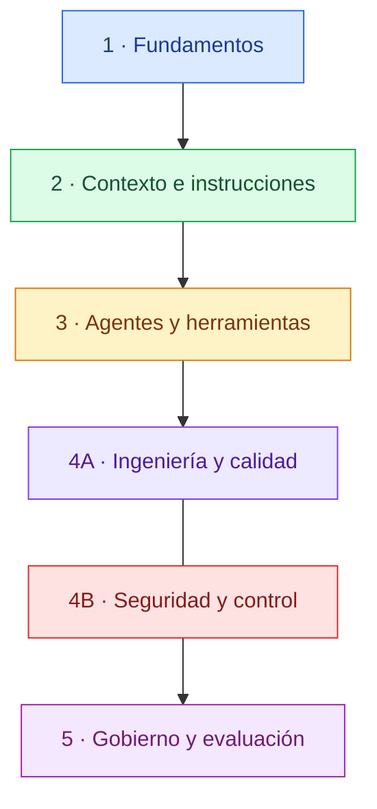

# Mapa de contenidos

Índice de consulta de la guía. **No es un curso obligatorio:** empieza por [Primeros pasos](primeros-pasos.md) y consulta cada módulo cuando tengas una necesidad concreta.

## Vista general

## Módulos

### 1. Fundamentos del desarrollo asistido

Cómo formular tareas, aportar contexto, planificar cambios y verificar resultados.

- [Primeros pasos](primeros-pasos.md)
- [Laboratorio 01: primer contacto](../laboratorio/01-primer-contacto/README.md)
- [Laboratorio 02: proyecto nuevo](../laboratorio/02-proyecto-nuevo/README.md)

### 2. Contexto e instrucciones

Cómo proporcionar contexto relevante y cuándo utilizar instrucciones persistentes, reglas y configuración del proyecto.

- [Referencias de herramientas](referencias-herramientas.md)
- [Diseño de ejercicios](estructura-ejercicios.md)
- [Laboratorio 03: proyecto existente](../laboratorio/03-proyecto-existente/README.md)
- [Laboratorio 04: configuración del entorno de IA](../laboratorio/04-configuracion-entorno-ia/README.md)

### 3. Agentes, herramientas y automatización

Agentes y subagentes, skills, hooks, MCP, permisos y delegación de tareas. Estos mecanismos resuelven necesidades distintas; no es necesario activarlos todos.

- [Referencias de herramientas](referencias-herramientas.md)
- [Laboratorio 04: configuración del entorno de IA](../laboratorio/04-configuracion-entorno-ia/README.md)

### 4A. Ingeniería del software y calidad

Pruebas, revisión de cambios, análisis estático, CI, *harness engineering* y *Spec-Driven Development*.

- [Primeros pasos: flujo de revisión](primeros-pasos.md)
- [Laboratorio 01: primer contacto](../laboratorio/01-primer-contacto/README.md)
- [Laboratorio 02: proyecto nuevo](../laboratorio/02-proyecto-nuevo/README.md)
- [Laboratorio 03: proyecto existente](../laboratorio/03-proyecto-existente/README.md)

### 4B. Seguridad, privacidad y control de cambios

Protección de datos y secretos, permisos mínimos, prompt injection, revisión humana y límites de autonomía.

- [Primeros pasos: seguridad y responsabilidad](primeros-pasos.md)
- [Referencias de herramientas](referencias-herramientas.md)
- [Laboratorio 04: configuración del entorno de IA](../laboratorio/04-configuracion-entorno-ia/README.md)

### 5. Gobierno, evaluación y mejora continua

Selección de herramientas, calidad, coste, privacidad, políticas de uso, métricas y mantenimiento de las prácticas.

- [Criterios de la guía](../README.md#principios)
- [Referencias de herramientas](referencias-herramientas.md)
- [Laboratorio: recorrido completo](../laboratorio/README.md)

## Proyectos y ejercicios de práctica

Los laboratorios contienen ejercicios y enlazan con los proyectos de práctica correspondientes. Se pueden recorrer de forma progresiva o consultar por necesidad.

| Proyecto o ejercicio | Objetivo | Referencia |
| --- | --- | --- |
| 01 · Primer contacto | Practicar chat, autocompletado y cambios pequeños en un script existente. | [Abrir laboratorio 01](../laboratorio/01-primer-contacto/README.md) |
| 02 · Proyecto nuevo | Convertir requisitos en un proyecto estructurado, con pruebas y una API REST. | [Abrir laboratorio 02](../laboratorio/02-proyecto-nuevo/README.md) |
| 03 · Proyecto existente | Analizar un repositorio, establecer una línea base y decidir qué necesita para trabajar con IA. | [Abrir laboratorio 03](../laboratorio/03-proyecto-existente/README.md) |
| 04 · Configuración del entorno de IA | Crear y validar instrucciones, rules y skills, y evaluar agentes, hooks y permisos según las necesidades. | [Abrir laboratorio 04](../laboratorio/04-configuracion-entorno-ia/README.md) |

## Cómo está organizada la documentación

- **Guía:** explica conceptos, criterios de decisión y riesgos.
- **Laboratorio:** permite practicar con ejercicios y proyectos con resultados verificables.
- **Referencias de herramientas:** agrupa los enlaces oficiales específicos de cada proveedor.

El estado de desarrollo de nuevos contenidos se debe gestionar como trabajo editorial, no como una lista de tareas dentro de este índice. Los ejercicios se enlazan desde los conceptos que permiten practicar.
