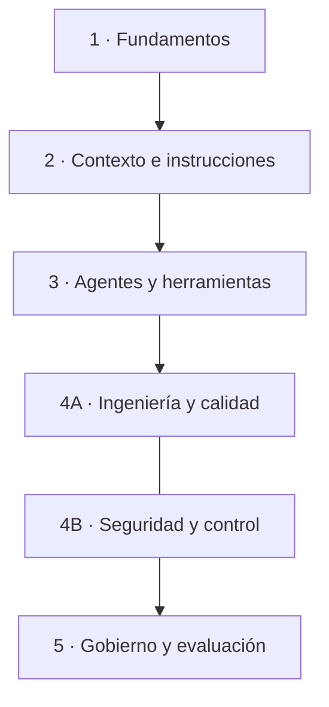

# Mapa de contenidos

Índice de consulta de la guía. **No es un curso obligatorio:** empieza por [Primeros pasos](primeros-pasos.md) y consulta cada módulo cuando tengas una necesidad concreta.

## Vista general

## Módulos

### 1. Fundamentos del desarrollo asistido

Cómo formular tareas, aportar contexto, planificar cambios y verificar resultados.

- [Primeros pasos](primeros-pasos.md)
- [Laboratorio: primer contacto](../laboratorio/01-primer-contacto/README.md)
- [Laboratorio: proyecto nuevo](../laboratorio/02-proyecto-nuevo/README.md)

### 2. Contexto e instrucciones

Cómo proporcionar contexto relevante y cuándo utilizar instrucciones persistentes, reglas y configuración del proyecto.

- [Referencias de herramientas](referencias-herramientas.md)
- [Diseño de ejercicios](estructura-ejercicios.md)
- [Laboratorio: proyecto existente](../laboratorio/03-proyecto-existente/README.md)

### 3. Agentes, herramientas y automatización

Agentes y subagentes, skills, hooks, MCP, permisos y delegación de tareas. Estos mecanismos resuelven necesidades distintas; no es necesario activarlos todos.

- [Referencias de herramientas](referencias-herramientas.md)
- [Laboratorios](../laboratorio/README.md)

### 4A. Ingeniería del software y calidad

Pruebas, revisión de cambios, análisis estático, CI, *harness engineering* y *Spec-Driven Development*.

- [Primeros pasos: flujo de revisión](primeros-pasos.md)
- [Laboratorios](../laboratorio/README.md)

### 4B. Seguridad, privacidad y control de cambios

Protección de datos y secretos, permisos mínimos, prompt injection, revisión humana y límites de autonomía.

- [Primeros pasos: seguridad y responsabilidad](primeros-pasos.md)
- [Referencias de herramientas](referencias-herramientas.md)

### 5. Gobierno, evaluación y mejora continua

Selección de herramientas, calidad, coste, privacidad, políticas de uso, métricas y mantenimiento de las prácticas.

- [Roadmap y trabajo pendiente](../ROADMAP.md)
- [Referencias de herramientas](referencias-herramientas.md)

## Cómo está organizada la documentación

- **Guía:** explica conceptos, criterios de decisión y riesgos.
- **Laboratorio:** permite practicar con proyectos y resultados verificables.
- **Referencias de herramientas:** agrupa los enlaces oficiales específicos de cada proveedor.
- **Roadmap:** registra propuestas y contenidos pendientes, separados de la guía consolidada.
