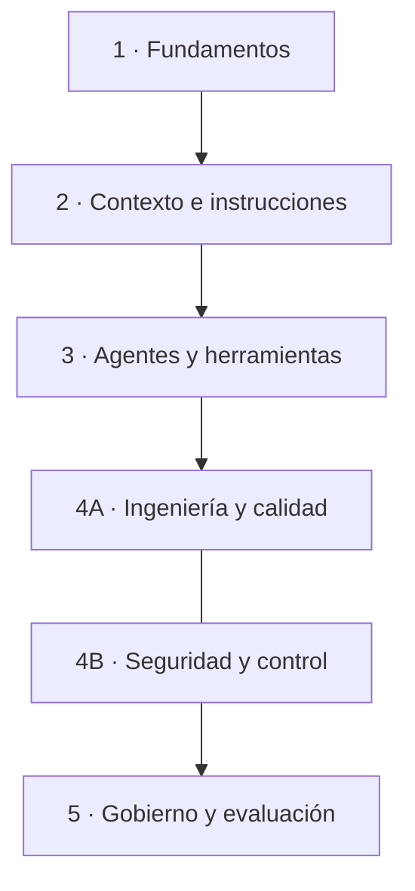

# Mapa de contenidos

Índice temático para localizar conceptos, metodologías y prácticas. **No es un curso obligatorio.** Para aprender de forma progresiva, consulta el [itinerario de aprendizaje](itinerario-aprendizaje.md); para empezar con una tarea pequeña, ve a [Primeros pasos](primeros-pasos.md).

## Vista general

Los módulos agrupan conocimientos relacionados. No representan por sí mismos una secuencia estricta: la progresión por competencias está descrita en el itinerario.

## Módulos

### 1. Fundamentos del desarrollo asistido

**Nivel recomendado:** 1–2.

- [Primeros pasos](primeros-pasos.md)
- [Glosario de términos](glosario.md)
- [LLM: familias de modelos, distribución y criterios de selección](referencias-llm.md)
- [Recursos complementarios](recursos-complementarios.md)
- [Laboratorio 01: primer contacto](../laboratorio/01-primer-contacto/README.md)
- [Laboratorio 02: proyecto nuevo](../laboratorio/02-proyecto-nuevo/README.md)

### 2. Contexto e instrucciones

**Nivel recomendado:** 2–3.

- [Instrucciones persistentes del proyecto](instrucciones-persistentes.md)
- [Herramientas de desarrollo asistido por IA](herramientas-desarrollo-ia.md)
- [Referencias de herramientas y documentación](referencias-herramientas.md)
- [Diseño de ejercicios](estructura-ejercicios.md)
- [Laboratorio 03: proyecto existente](../laboratorio/03-proyecto-existente/README.md)
- [Laboratorio 04: configuración del entorno de IA](../laboratorio/04-configuracion-entorno-ia/README.md)

### 3. Agentes, herramientas y automatización

**Nivel recomendado:** 3; consulta puntual posible en cualquier nivel.

Agentes y subagentes, skills, hooks, MCP, permisos y delegación de tareas. No es necesario activar todos los mecanismos.

- [Herramientas de desarrollo asistido por IA](herramientas-desarrollo-ia.md): categorías y selección de ejemplos representativos.
- [Glosario de términos](glosario.md)
- [Referencias de herramientas y documentación](referencias-herramientas.md)
- [Laboratorio 04: configuración del entorno de IA](../laboratorio/04-configuracion-entorno-ia/README.md)
- [Laboratorio 05: desarrollo de una funcionalidad con IA](../laboratorio/05-desarrollo-funcionalidad-ia/README.md)

### 4A. Ingeniería del software y calidad

**Nivel recomendado:** 1–4.

Pruebas, revisión de cambios, análisis estático, CI, *harness engineering* y *Spec-Driven Development*.

- [Primeros pasos: flujo de revisión](primeros-pasos.md)
- [Diseño de ejercicios](estructura-ejercicios.md)
- [Laboratorio 01](../laboratorio/01-primer-contacto/README.md)
- [Laboratorio 02](../laboratorio/02-proyecto-nuevo/README.md)
- [Laboratorio 03](../laboratorio/03-proyecto-existente/README.md)
- [Laboratorio 05: desarrollo de una funcionalidad con IA](../laboratorio/05-desarrollo-funcionalidad-ia/README.md)

### 4B. Seguridad, privacidad y control de cambios

**Nivel recomendado:** transversal; aplica desde el nivel 1.

Protección de datos y secretos, permisos mínimos, prompt injection, revisión humana y límites de autonomía.

- [Seguridad y privacidad al programar con IA](seguridad-privacidad-ia.md)
- [Glosario de términos](glosario.md)
- [Primeros pasos: seguridad y responsabilidad](primeros-pasos.md)
- [Referencias de herramientas](referencias-herramientas.md)
- [Laboratorio 04](../laboratorio/04-configuracion-entorno-ia/README.md)
- [Laboratorio 05: desarrollo de una funcionalidad con IA](../laboratorio/05-desarrollo-funcionalidad-ia/README.md)

### 5. Gobierno, evaluación y mejora continua

**Nivel recomendado:** 4–5, con principios de seguridad aplicables desde el inicio.

- [Criterios para aceptar cambios](../ROADMAP.md#criterios-para-aceptar-cambios)
- [Glosario de términos](glosario.md)
- [Referencias de herramientas](referencias-herramientas.md)
- [LLM: familias de modelos, distribución y criterios de selección](referencias-llm.md)
- [Itinerario de aprendizaje](itinerario-aprendizaje.md)
- [Laboratorio: recorrido completo](../laboratorio/README.md)

## Proyectos y ejercicios de práctica

| Laboratorio | Nivel principal | Objetivo | Referencia |
| --- | --- | --- | --- |
| 01 · Primer contacto | 1 | Practicar chat, autocompletado y cambios pequeños. | [Abrir laboratorio 01](../laboratorio/01-primer-contacto/README.md) |
| 02 · Proyecto nuevo | 2 | Convertir requisitos en un proyecto estructurado, con pruebas y API REST. | [Abrir laboratorio 02](../laboratorio/02-proyecto-nuevo/README.md) |
| 03 · Proyecto existente | 2 | Analizar el repositorio y establecer la línea base. | [Abrir laboratorio 03](../laboratorio/03-proyecto-existente/README.md) |
| 04 · Configuración del entorno de IA | 3 | Crear y validar instrucciones, rules y skills; evaluar agentes, hooks y permisos. | [Abrir laboratorio 04](../laboratorio/04-configuracion-entorno-ia/README.md) |
| 05 · Desarrollo de una funcionalidad con IA | 4 | Especificar, confirmar el plan, implementar por incrementos y validar. | [Abrir laboratorio 05](../laboratorio/05-desarrollo-funcionalidad-ia/README.md) |

El nivel indica la competencia principal, no limita el uso del laboratorio a personas de ese nivel.

## Cómo está organizada la documentación

- **Itinerario de aprendizaje:** niveles, objetivos, conocimientos previos y criterios de salida.
- **Guía conceptual:** conceptos, criterios de decisión y riesgos.
- **Laboratorio:** ejercicios y proyectos con resultados verificables.
- **Herramientas de desarrollo asistido por IA:** índice orientativo por categorías.
- **Referencias de herramientas:** enlaces oficiales específicos de cada proveedor.
- **Referencias de LLM:** familias de modelos, modalidades de distribución y criterios de selección.
- **Recursos complementarios:** artículos y experiencias externas que amplían la guía, sin sustituir fuentes oficiales.
- **Roadmap:** propuestas pendientes, no contenidos ya implementados.

El estado de desarrollo de nuevos contenidos se debe gestionar como trabajo editorial, no como una lista de tareas dentro de este índice.
