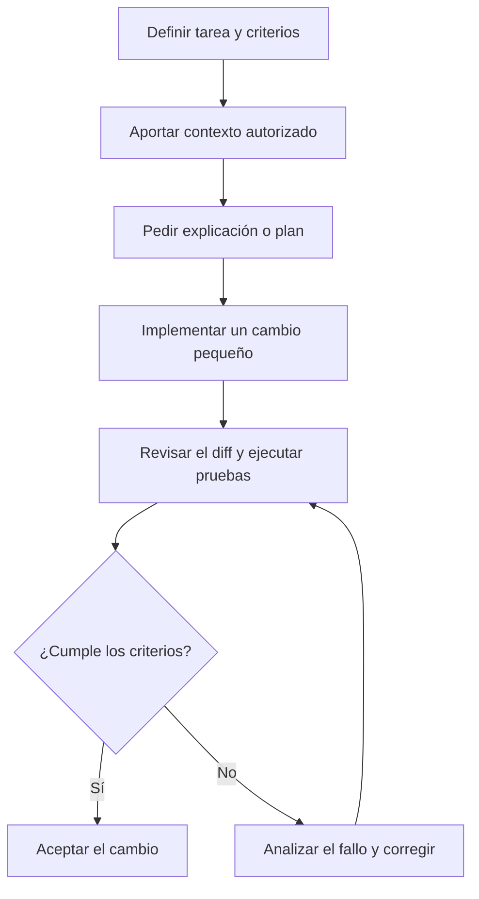

# Primeros pasos con asistentes de programación

Aprende primero un flujo de trabajo fiable. No necesitas configurar agentes, reglas, skills ni otros mecanismos avanzados para empezar.

## Tu primera tarea

Elige algo pequeño y comprobable en un proyecto que estés autorizado a utilizar. Por ejemplo, explicar una función, añadir una prueba o corregir un error reproducible.

1. **Define el objetivo.** Explica qué debería ocurrir y qué restricciones hay.
2. **Aporta contexto.** Comparte los archivos relevantes y evita información confidencial.
3. **Pide una propuesta.** Si no conoces bien el código, solicita primero una explicación. Para cambios no triviales, pide un plan breve.
4. **Acota el cambio.** Implementa una mejora cada vez y define cómo verificarla.
5. **Revisa el diff.** Comprueba los archivos modificados y entiende cada cambio.
6. **Ejecuta las pruebas.** Verifica el resultado con las pruebas y herramientas del proyecto. Si algo falla, utiliza el error como evidencia para la siguiente iteración.

## Qué probar primero

- Comprender una función o un módulo.
- Proponer casos de prueba.
- Añadir una prueba para un error reproducible.
- Incorporar una validación sencilla.
- Refactorizar una función pequeña sin cambiar su comportamiento.

Evita peticiones amplias como «reescribe el proyecto» o «mejora todo el código»: son difíciles de revisar y facilitan cambios innecesarios.

## Practicar

El [laboratorio](../laboratorio/README.md) contiene tres ejercicios progresivos:

- [01 · Primer contacto](../laboratorio/01-primer-contacto/README.md): chat, autocompletado y cambios pequeños.
- [02 · Proyecto nuevo](../laboratorio/02-proyecto-nuevo/README.md): requisitos, estructura y pruebas.
- [03 · Proyecto existente](../laboratorio/03-proyecto-existente/README.md): explorar el repositorio y modificarlo con seguridad.

El primer ejercicio utiliza Python y un ejemplo geográfico mínimo con coordenadas y GeoJSON; el método se puede trasladar a otros lenguajes.

## Cuándo configurar el entorno

Utiliza primero las funciones básicas de la herramienta aprobada por tu organización. Incorpora instrucciones persistentes, reglas, skills, hooks, agentes o MCP solo cuando exista una necesidad concreta y puedas explicar qué problema resuelve cada mecanismo.

Consulta las [referencias de herramientas](referencias-herramientas.md) para acceder a la documentación oficial de cada producto.

## Seguridad y responsabilidad

Comprueba las políticas de tu organización antes de utilizar IA con código de trabajo. No introduzcas secretos, credenciales ni datos confidenciales sin autorización. Revisa especialmente los cambios de archivos, comandos, accesos externos y acciones sobre sistemas compartidos.

El desarrollador sigue siendo responsable de comprender y validar los cambios que incorpora.
