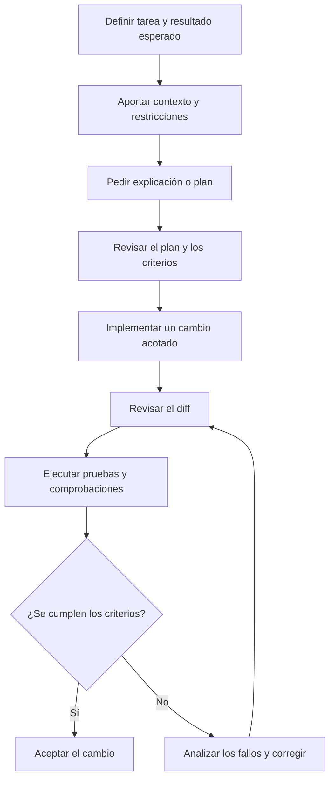

# Primeros pasos con asistentes de programación

Este documento explica cómo empezar a programar con ayuda de la IA. No necesitas configurar agentes, reglas, skills ni otros mecanismos avanzados para comenzar: primero aprende a plantear tareas pequeñas y a comprobar el código que recibes.

Si buscas enlaces de instalación y documentación específicos de cada producto, consulta las [referencias de herramientas](referencias-herramientas.md).

## Un flujo de trabajo inicial

1. **Elige una tarea concreta.** Por ejemplo, comprender una función, localizar un error, añadir una prueba o implementar una validación sencilla.
2. **Aporta contexto.** Explica qué hace el programa, qué resultado esperas y qué restricciones debe respetar. Comparte solo código y datos que estés autorizado a utilizar.
3. **Empieza por preguntar.** Si no conoces bien el código, pide una explicación y que indique los archivos o funciones relevantes, sin hacer cambios todavía.
4. **Divide el trabajo.** Para cambios no triviales, pide un plan breve y revisa si se ajusta al problema antes de pedir la implementación.
5. **Define cómo comprobarlo.** Especifica criterios de aceptación y pide pruebas para los casos normales, límites y errores esperables.
6. **Revisa el diff.** Comprueba qué archivos han cambiado, entiende el código y descarta modificaciones ajenas al objetivo.
7. **Ejecuta las comprobaciones.** Lanza las pruebas y herramientas de calidad del proyecto. No des por correcto un cambio solo porque el asistente diga que ha terminado.
8. **Itera con evidencia.** Si algo falla, comparte el error relevante y pide que explique la causa antes de aceptar otra modificación.

El flujo resume el ciclo habitual. No impide volver a una etapa anterior si la revisión descubre requisitos incompletos o un enfoque inadecuado.

## Qué tareas conviene probar primero

Empieza por actividades de bajo riesgo que permitan comprobar fácilmente el resultado:

- Explicar un módulo o una función.
- Proponer casos de prueba para una función existente.
- Escribir una prueba para un error reproducible.
- Añadir validación de entradas.
- Refactorizar una función pequeña manteniendo su comportamiento.
- Documentar cómo ejecutar una parte del proyecto.

Evita empezar con peticiones amplias como «reescribe el proyecto» o «mejora todo el código». Son difíciles de revisar y dejan demasiado margen para cambios innecesarios.

## Practicar con código

Los ejercicios deben aparecer en la sección de la guía que explica la práctica correspondiente. Desde allí se enlazará al proyecto del laboratorio que permite aplicarla, evitando duplicar las instrucciones y manteniendo las referencias de producto separadas.

El [laboratorio de desarrollo asistido por IA](../laboratorio/README.md) contiene tres proyectos progresivos:

1. **Primer contacto:** practicar comprensión de código, chat, autocompletado, cambios pequeños y pruebas en [01 · Primer contacto](../laboratorio/01-primer-contacto/README.md).
2. **Proyecto nuevo:** transformar requisitos en una implementación incremental con pruebas en [02 · Crear un proyecto nuevo](../laboratorio/02-proyecto-nuevo/README.md).
3. **Proyecto existente:** explorar un repositorio, añadir pruebas de caracterización y modificarlo con seguridad en [03 · Incorporar IA a un proyecto existente](../laboratorio/03-proyecto-existente/README.md).

El primer proyecto utiliza un ejemplo geográfico mínimo con coordenadas y GeoJSON. Aunque Python sea el lenguaje de partida, el método se puede aplicar a otros lenguajes.

## Cuándo configurar el entorno

Al principio, utiliza las funciones básicas de la herramienta aprobada por tu organización. Incorpora archivos de instrucciones, reglas, skills, hooks, agentes o MCP cuando exista una necesidad concreta y puedas explicar qué problema resuelve cada elemento. Más configuración no implica automáticamente mejores resultados.

## Seguridad y responsabilidad

Antes de utilizar IA con código de trabajo, verifica las políticas de tu organización y las condiciones de la herramienta. No introduzcas secretos, credenciales ni datos confidenciales sin autorización. Revisa especialmente las acciones que puedan modificar archivos, ejecutar comandos, acceder a servicios externos o afectar a sistemas compartidos.

El desarrollador sigue siendo responsable de comprender y validar los cambios que incorpora.
