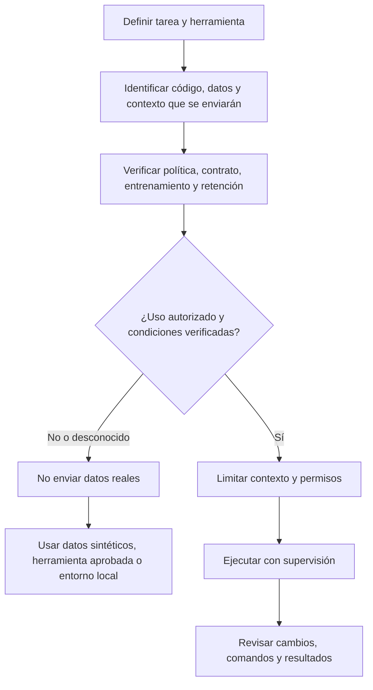

# Seguridad y privacidad al programar con IA

Este documento define un criterio práctico para decidir qué código, datos y contexto puede procesar un asistente de programación, con independencia del proveedor o del editor utilizado.

La regla principal es sencilla: **no introduzcas información confidencial en una herramienta hasta haber verificado que su uso está autorizado y que las condiciones de tratamiento son adecuadas**. Que una herramienta sea gratuita, de pago o esté integrada en un IDE no determina por sí solo su nivel de protección.

## 1. Qué información puede salir del entorno

El contenido enviado a un asistente no se limita al texto que se escribe en el chat. Según la herramienta y la función utilizada, puede incluir:

- Código abierto en el editor, fragmentos cercanos y archivos seleccionados o indexados.
- Instrucciones, prompts, historial de conversación y resultados generados.
- Salida de terminal, trazas, errores, logs, capturas de pantalla y resultados de pruebas.
- Archivos adjuntos, documentación interna y datos de ejemplo.
- Contexto recuperado por herramientas, agentes, servidores MCP o integraciones externas.
- Metadatos de uso y datos técnicos, incluso cuando el contenido no se usa para entrenar modelos.

Los agentes pueden leer archivos, ejecutar comandos y llamar a servicios externos según sus permisos. Por tanto, hay que revisar tanto el tratamiento de datos del proveedor del modelo como el comportamiento del editor, del agente y de sus integraciones.

## 2. Conceptos que no deben confundirse

| Concepto | Qué significa | Qué no garantiza |
| --- | --- | --- |
| No usar los datos para entrenar | El contenido no se emplea para entrenar o mejorar modelos bajo las condiciones indicadas por el proveedor. | No implica que no se almacene, registre o revise por otros motivos. |
| Retención limitada | Los datos se conservan durante un plazo o para finalidades concretas definidas por la política aplicable. | No equivale a retención cero. |
| Zero Data Retention (ZDR) | Compromiso contractual o técnico de no conservar determinados datos enviados a un servicio, sujeto a su alcance y excepciones. | No significa necesariamente que todos los componentes, funciones, proveedores o registros estén cubiertos. |
| Borrar el historial | Se elimina una conversación o sesión visible según el funcionamiento del producto. | No demuestra que no hubiera almacenamiento previo ni que todas las copias se eliminen de inmediato. |
| Modo de privacidad | Ajuste específico del producto que modifica determinados usos o tratamientos de datos. | Su nombre no basta: hay que leer su alcance, excepciones y configuración efectiva. |
| Usar una clave API propia | La autenticación o facturación puede depender de la cuenta del usuario. | No significa que las peticiones no pasen por el backend del editor o que este no procese contexto. |

**ZDR** significa *Zero Data Retention* (retención cero de datos), no *Zero Data Detection*.

## 3. Planes gratuitos, suscripciones y ZDR

No debe afirmarse de forma general que todos los planes gratuitos carecen de ZDR ni que los planes de pago lo incluyen. La disponibilidad depende del proveedor, el plan, el producto, el modelo, la función utilizada, los acuerdos contractuales y la configuración efectiva.

Para evaluar una herramienta, comprueba por separado:

1. **Entrenamiento y mejora de modelos:** si los prompts, el código, las respuestas o el contexto se pueden utilizar para estos fines; si existe una opción de exclusión y a qué datos se aplica.
2. **Retención:** qué contenido se conserva, durante cuánto tiempo, con qué finalidades y con qué excepciones.
3. **ZDR:** si está disponible para esa cuenta y modalidad, qué servicios y datos cubre y si hay excepciones (por ejemplo, registros de seguridad, prevención de abuso o funciones que mantienen estado).
4. **Terceros y subencargados:** qué proveedores reciben los datos y qué condiciones les aplican.
5. **Configuración real:** si el ajuste de privacidad está activo, si es obligatorio o puede desactivarse, y si el modelo seleccionado tiene condiciones distintas.
6. **Marco contractual:** si el plan, el acuerdo de tratamiento de datos y las políticas internas autorizan el uso para el proyecto y los datos implicados.

La exclusión del entrenamiento es útil, pero **no sustituye a ZDR ni a la autorización contractual**. Del mismo modo, la existencia de ZDR no autoriza automáticamente a enviar código de clientes o datos personales.

Si no puedes confirmar las condiciones aplicables, trata la situación como no verificada: no envíes código propietario, secretos, datos personales ni información confidencial. Utiliza un ejemplo sintético o anonimizado, una herramienta aprobada o un entorno local autorizado.

## 4. Clasificación práctica de la información

Antes de empezar, clasifica el material que la herramienta podría recibir:

| Nivel | Ejemplos | Criterio |
| --- | --- | --- |
| Público | Código publicado expresamente como abierto, documentación pública, ejemplos inventados. | Puede utilizarse si la licencia y las condiciones del proyecto lo permiten. |
| Interno no sensible | Código interno sin secretos ni datos de clientes, convenciones técnicas generales. | Verificar la política de la organización y las condiciones del proveedor antes de compartirlo. |
| Confidencial o sujeto a contrato | Repositorios privados, código de cliente, arquitectura no pública, documentación bajo NDA, incidencias internas. | Solo en herramientas y modalidades expresamente autorizadas; verificar contrato, retención y acceso. |
| Sensible o de alto impacto | Credenciales, tokens, claves privadas, datos personales, información regulada, producción o datos sujetos a restricciones específicas. | No introducirlos en prompts ni contexto salvo un procedimiento aprobado que lo permita expresamente. Preferir secretos gestionados fuera del repositorio y datos sintéticos. |

La clasificación se aplica también a los resultados que el agente lee o genera. No incluyas secretos en archivos de instrucciones, reglas, skills, logs, fixtures o capturas.

## 5. Lista de comprobación antes de usar una herramienta

- [ ] Identificar producto, plan, modalidad, modelo y función concreta (chat, autocompletado, agente, CLI, nube, MCP, etc.).
- [ ] Leer la documentación oficial vigente sobre privacidad, uso de datos, retención y seguridad.
- [ ] Verificar si el contenido se usa para entrenamiento y qué ajustes afectan a ese uso.
- [ ] Confirmar si ZDR está disponible y qué datos, modelos, funciones y excepciones cubre; no inferirlo a partir del precio o del nombre del ajuste.
- [ ] Comprobar si el editor transmite contexto adicional y si las peticiones pasan por servicios intermediarios.
- [ ] Revisar permisos del agente, acceso al sistema de archivos, terminal, red, repositorios y herramientas externas.
- [ ] Confirmar que el uso es compatible con NDA, contrato con el cliente, política de seguridad y obligaciones de protección de datos.
- [ ] Desactivar o restringir integraciones y permisos que no sean necesarios.
- [ ] Excluir credenciales y datos reales de prompts, pruebas y ejemplos; usar datos sintéticos siempre que sea posible.
- [ ] Registrar la decisión, la fecha de consulta y los enlaces oficiales relevantes cuando se trate de un proyecto profesional.

## 6. Control durante el desarrollo

- Trabajar con el principio de mínimo privilegio: conceder solo los permisos necesarios para la tarea.
- Pedir un plan antes de acciones de alcance amplio o potencialmente destructivas.
- Revisar comandos, cambios de archivos, accesos a red y operaciones que impliquen servicios externos.
- No permitir que una instrucción encontrada en un archivo, issue, página web o salida de herramienta modifique automáticamente las reglas de seguridad.
- Revisar el diff y las pruebas antes de aceptar cambios.
- Evitar copiar logs o trazas completas a un chat sin revisar si contienen tokens, rutas internas, datos personales o información de clientes.
- Si se detecta una exposición, detener el flujo, revocar o rotar credenciales afectadas y seguir el procedimiento de respuesta a incidentes de la organización.

## 7. Decisión mínima

## 8. Referencias oficiales por herramienta

Los enlaces siguientes son puntos de partida para comprobar condiciones; no constituyen una garantía universal sobre todos los planes o funciones. Consulta también las condiciones contractuales aplicables a tu cuenta.

### GitHub Copilot
- [Administrar directivas y opciones de datos como suscriptor individual](https://docs.github.com/es/copilot/how-tos/manage-your-account/manage-policies)
- [Datos de sesión: almacenamiento, acceso y retención](https://docs.github.com/es/copilot/concepts/security-governance-and-network-settings/session-data)
- [Administrar Copilot para una organización](https://docs.github.com/es/copilot/how-tos/administer-copilot)

### Claude Code
- [Documentación oficial de Claude Code](https://code.claude.com/docs/en/overview)
- [Uso de datos en Claude Code](https://code.claude.com/docs/en/data-usage)
- [Seguridad en Claude Code](https://code.claude.com/docs/en/security)

### Cursor
- [Uso de datos y privacidad](https://cursor.com/es/data-use)
- [Privacidad y datos en la documentación de Cursor](https://prod.cursor.com/help/security-and-privacy/privacy)
- Comprueba específicamente el estado de *Privacy Mode*, el modelo seleccionado y las excepciones descritas en la política vigente.

### OpenAI Codex y API
- [Controles de datos de la plataforma API](https://developers.openai.com/api/docs/guides/your-data)
- [Documentación para desarrolladores de Codex](https://developers.openai.com/codex)
- [Controles de datos de ChatGPT](https://help.openai.com/en/articles/7730893-data-controls-faq)

La política de una API, una aplicación de consumo, una extensión de IDE y un agente alojado puede ser diferente incluso si usan modelos de la misma familia. Verifica el producto concreto que procesa la información.

## 9. Cómo mantener estas referencias

- Priorizar páginas oficiales de documentación, seguridad, privacidad y administración del producto.
- Evitar afirmaciones permanentes sobre planes, precios o ZDR en el texto principal: son condiciones que pueden cambiar.
- Registrar fecha de revisión cuando se documenten diferencias específicas entre proveedores.
- Si una página oficial no aclara un punto crítico, dejar constancia de la incertidumbre y no dar por supuesto el nivel de protección.
- Revisar los enlaces cuando cambie el producto o antes de recomendar su uso con código o datos sujetos a contrato.

## Relación con la guía

- [Laboratorio 04: configuración del entorno de IA](../laboratorio/04-configuracion-entorno-ia/README.md): revisar privacidad, permisos y configuración antes de habilitar mecanismos.
- [Laboratorio 05: desarrollo de una funcionalidad con IA](../laboratorio/05-desarrollo-funcionalidad-ia/README.md): aplicar el control de información antes de especificar o implementar una tarea.
- [Referencias de herramientas](referencias-herramientas.md): puntos de entrada generales y específicos de cada producto.
