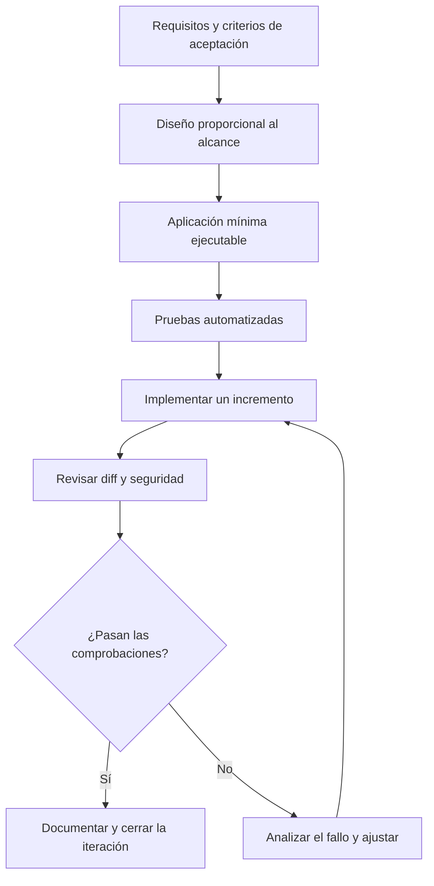

# 02 · Crear un proyecto nuevo

## Objetivo

Practicar el desarrollo asistido por IA desde requisitos iniciales hasta una aplicación pequeña, con una estructura mantenible y comprobaciones automatizadas.

## Enunciado

Construye una API REST para gestionar puntos de interés geográficos. Cada punto tendrá identificador, nombre, categoría y coordenadas. La API deberá devolver datos GeoJSON cuando proceda.

## Etapas sugeridas

1. **Definir alcance:** pide al asistente que convierta el enunciado en requisitos y criterios de aceptación. Aclara qué queda fuera de la primera versión.
2. **Diseñar antes de generar:** solicita una propuesta de módulos, modelos y errores esperables. Revisa si la estructura es proporcional al tamaño del proyecto.
3. **Crear el mínimo ejecutable:** configura un entorno virtual, dependencias y una aplicación pequeña que arranque.
4. **Añadir pruebas:** valida entradas, límites geográficos, respuestas HTTP y errores. No dejes las pruebas para el final.
5. **Implementar por incrementos:** añade primero operaciones en memoria; introduce persistencia solo cuando los requisitos la justifiquen.
6. **Documentar la configuración:** registra cómo instalar, ejecutar y probar. Añade instrucciones para el asistente (por ejemplo, `AGENTS.md`) solo con convenciones útiles y comprobables.
7. **Revisar seguridad:** valida entradas, evita secretos en el repositorio y no habilites herramientas o permisos del agente sin necesidad.

El proceso es iterativo: las pruebas y la revisión pueden revelar que hay que ajustar la implementación, el diseño o incluso los criterios de aceptación.

## Criterios de aceptación iniciales

- La API permite consultar puntos y recuperar un punto por identificador.
- Las entradas inválidas producen errores consistentes y comprensibles.
- La representación geográfica sigue GeoJSON y mantiene el orden longitud/latitud.
- Las pruebas pueden ejecutarse con un único comando documentado.
- Una persona nueva puede instalar y arrancar el proyecto siguiendo el README.

## Tecnologías

Python, pytest y FastAPI son suficientes para esta etapa. Añade Ruff u otras herramientas de calidad cuando puedas explicar qué problema resuelven. Deja PostGIS, Docker, frontend y despliegue para iteraciones posteriores.

## Uso de IA

Pide al asistente que trabaje por etapas y que indique los archivos que va a crear o modificar. Revisa cada diff, ejecuta las pruebas y evita aceptar una arquitectura compleja solo porque el modelo la proponga.

Este ejercicio es una especificación de trabajo; todavía no incluye una implementación de la API.
