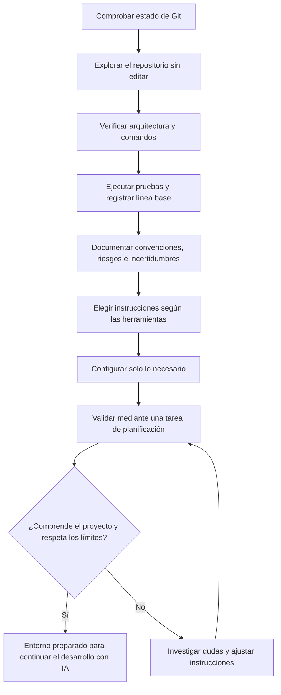

# 03 · Preparar un proyecto existente para trabajar con IA

## Objetivo

Preparar un repositorio existente para continuar su desarrollo con asistentes de programación. Al terminar, el desarrollador debe conocer la estructura y los límites del proyecto, disponer de una línea base verificable y haber decidido qué instrucciones y configuración necesita su herramienta de IA.

El laboratorio se centra en **comprender y configurar antes de delegar cambios**. No exige implementar una funcionalidad nueva ni crear archivos de instrucciones para todos los asistentes.

## Proyecto de práctica

- Utiliza una copia de un proyecto propio no confidencial o el repositorio de práctica.
- Comprueba las políticas de la organización antes de enviar código a un servicio de IA.
- No incluyas credenciales, datos personales, secretos ni información contractual.
- Trabaja con Git y registra el estado inicial. No sobrescribas cambios preexistentes.

## Ejercicios

### 1. Reconocimiento sin modificaciones

Pide al asistente que investigue el repositorio sin editar archivos. Solicita un informe que incluya:

- lenguaje, tecnologías y estructura de directorios;
- puntos de entrada y módulos principales;
- dependencias y archivos de configuración;
- comandos para instalar, ejecutar, probar y validar;
- pruebas existentes y cobertura conocida, si se puede comprobar;
- documentación, CI y proceso de despliegue que encuentre.

Exige referencias a rutas concretas. Comprueba las afirmaciones importantes directamente en el repositorio. El asistente debe señalar lo que no pueda verificar, no rellenar huecos con suposiciones.

### 2. Línea base técnica

Ejecuta los comandos disponibles antes de realizar cambios:

- estado de Git y cambios pendientes;
- instalación o preparación del entorno, si procede;
- pruebas automatizadas;
- linters, formateadores, análisis estático o compilación que ya utilice el proyecto.

Registra los comandos ejecutados y sus resultados. Distingue entre fallos previos, herramientas que no están configuradas y comprobaciones que no se han podido ejecutar. No añadas dependencias ni cambies la configuración solo para conseguir una ejecución limpia.

### 3. Convenciones, riesgos y límites

Pide al asistente que identifique convenciones demostrables y zonas de riesgo: módulos críticos, ausencia de pruebas, dependencias externas, generación de archivos, migraciones, configuración sensible y operaciones con efectos secundarios.

Contrasta las conclusiones con el código, la documentación y la configuración real. Anota las dudas pendientes. No conviertas las sugerencias del asistente en reglas del proyecto hasta haberlas validado.

### 4. Configurar las instrucciones de la herramienta

Decide qué mecanismo de instrucciones persistentes corresponde a las herramientas que se van a utilizar. Las instrucciones deben ser breves, comprobables y útiles para tareas recurrentes:

- descripción y arquitectura del proyecto, solo en la medida en que ayude a trabajar;
- comandos reales de desarrollo y validación;
- convenciones observadas en el código;
- límites de alcance y política para cambios no solicitados;
- criterios de pruebas, revisión del diff y comunicación de incertidumbres;
- restricciones de seguridad y tratamiento de secretos.

**No crees todos los archivos de instrucciones por defecto.** Si se usan varias herramientas, comprueba qué formatos admite cada una y evita duplicar contenido que pueda divergir. Mantén una fuente común cuando sea compatible y añade archivos específicos solo si son necesarios.

| Concepto agnóstico | Ejemplos de nombres o mecanismos | Criterio |
| --- | --- | --- |
| Instrucciones generales del repositorio | `AGENTS.md` en herramientas compatibles | Usarlo si las herramientas elegidas lo leen y el contenido es compartido. |
| Instrucciones específicas de Claude Code | `CLAUDE.md` | Añadirlo cuando se utilice Claude Code; puede remitir a instrucciones compartidas si el formato y la herramienta lo permiten. |
| Instrucciones específicas de GitHub Copilot | `.github/copilot-instructions.md` y, en entornos compatibles, instrucciones por ruta | Elegir según el producto y el ámbito que se quiera cubrir. |
| Configuración propia de una herramienta | Archivos de configuración, reglas o ajustes del cliente | Añadirla solo cuando resuelva una necesidad concreta; no equivale necesariamente a un archivo de instrucciones. |

Los nombres y capacidades dependen de la herramienta y pueden cambiar. Antes de crear archivos, consulta la documentación oficial vigente de los asistentes que realmente se vayan a usar. La tabla es orientativa, no una garantía de compatibilidad universal.

### 5. Validar la preparación sin cambiar código

Pide al asistente que resuma cómo abordaría una incidencia pequeña y que proponga un plan, los archivos que investigaría, las pruebas que ejecutaría y los riesgos que revisaría. En esta fase debe **explicar y planificar, no implementar**.

Comprueba que utiliza las instrucciones y los comandos reales del repositorio, reconoce las incertidumbres y respeta el alcance. Revisa el estado de Git al terminar y confirma que el ejercicio no ha introducido cambios no autorizados.

## Entregables

- Inventario técnico con referencias a archivos.
- Registro de la línea base: comandos, resultados y limitaciones.
- Mapa breve de riesgos y cuestiones pendientes.
- Decisión justificada sobre los mecanismos de instrucciones que se necesitan.
- Instrucciones de proyecto mínimas, solo para las herramientas seleccionadas.
- Resultado de la validación final y estado de Git.

## Flujo de trabajo

## Criterios de aceptación

- El informe distingue hechos comprobados de hipótesis y señala las fuentes del repositorio.
- Los comandos documentados se han encontrado y ejecutado cuando el entorno lo permite; las limitaciones están registradas.
- La línea base separa problemas preexistentes de cambios introducidos durante el ejercicio.
- Los riesgos y las incertidumbres relevantes quedan documentados.
- Los archivos de instrucciones se justifican por las herramientas elegidas; no se generan por rutina.
- Las instrucciones no inventan convenciones, comandos ni capacidades del proyecto.
- La validación se completa sin cambios de código no solicitados.
- El estado final de Git se revisa y cualquier cambio queda explicado.

## Regla de trabajo

No empieces pidiendo «mejora todo el proyecto». Empieza por entender qué existe, cómo se comprueba y qué límites debe respetar el asistente. La implementación de cambios y las pruebas de caracterización pertenecen a la fase de desarrollo posterior, cuando ya se conoce la línea base.

## Documentación oficial para verificar formatos

- [GitHub Copilot: personalizar respuestas](https://docs.github.com/en/copilot/customizing-copilot)
- [Claude Code: memoria e instrucciones del proyecto](https://docs.anthropic.com/en/docs/claude-code/memory)
- [AGENTS.md: repositorio del formato](https://github.com/agentsmd/agents.md)
