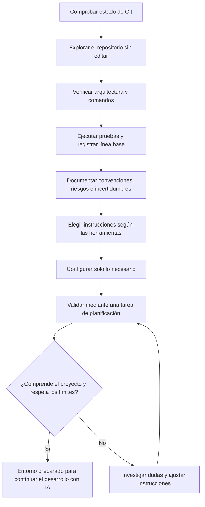

# 03 · Preparar un proyecto existente para trabajar con IA

## Objetivo

Preparar un repositorio existente para continuar su desarrollo con asistentes de programación. Al terminar, el desarrollador debe conocer la estructura y los límites del proyecto, disponer de una línea base verificable y haber decidido qué instrucciones y configuración necesita su herramienta de IA.

El laboratorio se centra en **comprender y configurar antes de delegar cambios**. No exige implementar una funcionalidad nueva ni crear archivos de instrucciones para todos los asistentes.

## Proyecto de práctica

- Utiliza un proyecto propio no confidencial o copia el proyecto incluido en [`project/`](project/README.md) a un directorio fuera del repositorio de la guía.
- Abre únicamente esa copia independiente como espacio de trabajo del asistente y utiliza su propio repositorio Git. Este README contiene las tareas sugeridas con IA; el README dentro de la copia documenta el proyecto. Proporciona las instrucciones del ejercicio explícitamente al asistente cuando las necesite. Sigue el [procedimiento común de copia independiente](../README.md#copia-independiente-obligatoria).
- Utiliza la misma copia en los laboratorios 04 y 05. El laboratorio 04 incluye además una réplica de este proyecto con las instrucciones generales ya creadas, para quien empiece directamente por él.
- Comprueba las políticas de la organización antes de enviar código a un servicio de IA.
- No incluyas credenciales, datos personales, secretos ni información contractual.
- Trabaja con Git y registra el estado inicial. No sobrescribas cambios preexistentes.

## Ejercicios

### 1. Reconocimiento sin modificaciones

Pide al asistente que investigue el repositorio sin editar archivos. Solicita un informe que incluya:

- lenguaje, tecnologías y estructura de directorios;
- puntos de entrada y módulos principales;
- dependencias y archivos de configuración;
- comandos para instalar, ejecutar, probar y validar;
- pruebas existentes y cobertura conocida, si se puede comprobar;
- documentación, CI y proceso de despliegue que encuentre.

Exige referencias a rutas concretas. Comprueba las afirmaciones importantes directamente en el repositorio. El asistente debe señalar lo que no pueda verificar, no rellenar huecos con suposiciones.

### 2. Línea base técnica

Ejecuta los comandos disponibles antes de realizar cambios:

- estado de Git y cambios pendientes;
- instalación o preparación del entorno, si procede;
- pruebas automatizadas;
- linters, formateadores, análisis estático o compilación que ya utilice el proyecto.

Registra los comandos exactos, el resultado observado y el entorno en que se ejecutaron. Para este proyecto de práctica, comprueba como mínimo el estado de Git y ejecuta las pruebas y las comprobaciones de calidad con los comandos que documente el proyecto (por ejemplo, `python -m pytest`, `python -m ruff check .`, `python -m ruff format --check .` y `python -m mypy`, si las herramientas están instaladas). Si una orden falla, conserva el error relevante y explica si se debe a una regresión, al entorno o a una configuración ausente; no lo clasifiques sin evidencia. Distingue entre pruebas ejecutadas, no ejecutadas y no disponibles. No añadas dependencias ni cambies la configuración solo para conseguir una ejecución limpia.

### 3. Convenciones, riesgos y límites

Pide al asistente que identifique convenciones demostrables y zonas de riesgo: módulos críticos, ausencia de pruebas, dependencias externas, generación de archivos, migraciones, configuración sensible y operaciones con efectos secundarios.

Contrasta las conclusiones con el código, la documentación y la configuración real. Para cada conclusión importante, registra la ruta o salida que la respalda y etiqueta como **hecho comprobado**, **hipótesis** o **pendiente de verificar**. Anota las dudas pendientes. No conviertas las sugerencias del asistente en reglas del proyecto hasta haberlas validado.

### 4. Configurar las instrucciones de la herramienta

Antes de empezar, lee [Instrucciones persistentes del proyecto](../../docs/instrucciones-persistentes.md): qué incluir, cómo evitar duplicados entre herramientas y cómo comprobar que se aplican.

En este laboratorio solo se crean las **instrucciones generales del repositorio**. Las reglas por ruta, las skills, los hooks y los permisos se tratan en el [laboratorio 04](../04-configuracion-entorno-ia/README.md).

Decide qué mecanismo de instrucciones persistentes corresponde a las herramientas que se van a utilizar. Las instrucciones deben ser breves, comprobables y útiles para tareas recurrentes:

- descripción y arquitectura del proyecto, solo en la medida en que ayude a trabajar;
- comandos reales de desarrollo y validación;
- convenciones observadas en el código;
- límites de alcance y política para cambios no solicitados;
- criterios de pruebas, revisión del diff y comunicación de incertidumbres;
- restricciones de seguridad y tratamiento de secretos.

**No crees todos los archivos de instrucciones por defecto.** Si se usan varias herramientas, comprueba qué formatos admite cada una y evita duplicar contenido que pueda divergir. Mantén una fuente común cuando sea compatible y añade archivos específicos solo si son necesarios.

| Concepto agnóstico | Ejemplos de nombres o mecanismos | Criterio |
| --- | --- | --- |
| Instrucciones generales del repositorio | `AGENTS.md` en herramientas compatibles | Usarlo si las herramientas elegidas lo leen y el contenido es compartido. |
| Instrucciones específicas de Claude Code | `CLAUDE.md` | Claude Code lee `AGENTS.md` si no hay `CLAUDE.md`. Añadirlo solo si hacen falta instrucciones propias de Claude Code o la sesión no carga `AGENTS.md`; en ese caso, que lo importe con `@AGENTS.md`. |
| Instrucciones específicas de GitHub Copilot | `.github/copilot-instructions.md` y, en entornos compatibles, instrucciones por ruta | Elegir según el producto y el ámbito que se quiera cubrir. |
| Configuración propia de una herramienta | Archivos de configuración, reglas o ajustes del cliente | Fuera del alcance de este laboratorio; se evalúa en el laboratorio 04. |

Los nombres y capacidades dependen de la herramienta y pueden cambiar. Antes de crear archivos, consulta la documentación oficial vigente de los asistentes que realmente se vayan a usar. La tabla es orientativa, no una garantía de compatibilidad universal.

#### Crear instrucciones generales

Si eliges `AGENTS.md`:

1. Revisa primero si ya existen instrucciones equivalentes.
2. Resume solo hechos comprobados: propósito, comandos reales, convenciones, pruebas y límites.
3. No dupliques el README ni inventes comandos o normas.
4. Consulta la documentación oficial de cada herramienta; no todas cargan el mismo formato.
5. Abre una sesión nueva y comprueba que las instrucciones se aplican. Registra el resultado.

Si una herramienta no admite `AGENTS.md`, utiliza su mecanismo específico solo cuando sea necesario y evita mantener copias divergentes.

El ejercicio 5 completa la validación con una tarea de planificación.

### 5. Validar la preparación sin cambiar código

Pide al asistente que resuma cómo abordaría una incidencia pequeña y que proponga un plan, los archivos que investigaría, las pruebas que ejecutaría y los riesgos que revisaría. En esta fase debe **explicar y planificar, no implementar**.

Comprueba que utiliza las instrucciones y los comandos reales del repositorio, reconoce las incertidumbres y respeta el alcance. Revisa el estado de Git al terminar y confirma que el ejercicio no ha introducido cambios no autorizados.

## Entregables

- Inventario técnico con referencias a archivos y distinción entre hechos, hipótesis y dudas.
- Registro reproducible de la línea base: estado inicial de Git, comandos exactos, resultados observados y limitaciones.
- Mapa breve de riesgos y cuestiones pendientes, con evidencia o motivo de la duda.
- Decisión justificada sobre los mecanismos de instrucciones que se necesitan.
- Instrucciones de proyecto mínimas, solo para las herramientas seleccionadas.
- Resultado de la validación final y estado final de Git, indicando cualquier cambio inesperado.

### Plantilla mínima para registrar la línea base

| Comprobación | Comando o evidencia | Resultado observado | Estado |
| --- | --- | --- | --- |
| Estado de Git | `git status --short --branch` | Anotar la salida real | Ejecutado / pendiente |
| Pruebas | Comando definido por el proyecto | Anotar resumen y fallos reales | Pasan / fallan / no ejecutadas |
| Calidad adicional | Solo si existe configuración | Anotar salida o indicar que no está configurada | Ejecutado / no disponible |

No rellenes la tabla con resultados esperados ni supongas que las pruebas pasan por el mero hecho de que existan archivos de test.

## Flujo de trabajo

## Criterios de aceptación

- El informe distingue hechos comprobados de hipótesis y señala las fuentes del repositorio.
- Los comandos documentados se han encontrado y ejecutado cuando el entorno lo permite; las limitaciones están registradas.
- La línea base separa problemas preexistentes de cambios introducidos durante el ejercicio.
- Los riesgos y las incertidumbres relevantes quedan documentados.
- Los archivos de instrucciones se justifican por las herramientas elegidas; no se generan por rutina.
- Las instrucciones no inventan convenciones, comandos ni capacidades del proyecto.
- La validación se completa sin cambios de código no solicitados.
- El estado final de Git se revisa y cualquier cambio queda explicado.

## Regla de trabajo

No empieces pidiendo «mejora todo el proyecto». Empieza por entender qué existe, cómo se comprueba y qué límites debe respetar el asistente. La implementación de cambios y las pruebas de caracterización pertenecen a la fase de desarrollo posterior, cuando ya se conoce la línea base.

## Documentación oficial para verificar formatos

- [GitHub Copilot: personalizar respuestas](https://docs.github.com/en/copilot/customizing-copilot)
- [Claude Code: memoria e instrucciones del proyecto](https://code.claude.com/docs/en/memory)
- [AGENTS.md: guía oficial del formato](https://agents.md/)
- [AGENTS.md: repositorio del formato](https://github.com/agentsmd/agents.md)
- [GitHub Copilot: instrucciones del repositorio, incluido AGENTS.md](https://docs.github.com/en/copilot/how-tos/configure-custom-instructions/add-repository-instructions)
