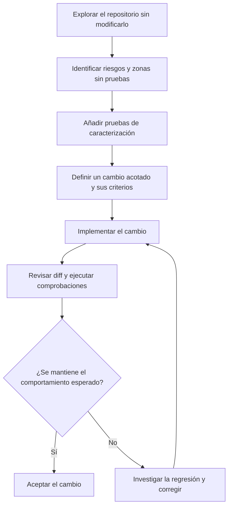

# 03 · Incorporar IA a un proyecto existente

## Objetivo

Aprender a utilizar asistentes en un repositorio que ya tiene estructura, decisiones técnicas y posiblemente deuda técnica, sin iniciar una reescritura innecesaria.

## Preparación

Utiliza una copia de un proyecto propio no confidencial o un repositorio de práctica. Si empleas código de la empresa, confirma antes las políticas de uso de IA y elimina credenciales y datos sensibles.

## Ejercicios

1. **Exploración sin cambios:** pide al asistente que describa la estructura, el punto de entrada, las dependencias y las pruebas existentes. Exige referencias a archivos concretos y comprueba la respuesta.
2. **Mapa de riesgos:** solicita que identifique zonas sin pruebas, dependencias externas y áreas donde un cambio podría tener efectos secundarios. Trata sus conclusiones como hipótesis que debes verificar.
3. **Pruebas de caracterización:** elige una función existente y añade pruebas que documenten su comportamiento actual antes de refactorizarla.
4. **Cambio acotado:** formula una incidencia pequeña con criterios de aceptación y límites explícitos. Pide un plan si afecta a varios módulos.
5. **Verificación:** ejecuta pruebas y herramientas de calidad existentes; compara el diff con el alcance solicitado.
6. **Instrucciones de proyecto:** cuando conozcas las convenciones reales, redacta instrucciones breves para el asistente. Evita reglas redundantes o instrucciones que no puedas comprobar.

El orden importa: primero comprende el comportamiento existente y reduce la incertidumbre; después cambia una parte acotada y verifica que no has introducido regresiones.

## Criterios de aceptación

- No se han alterado archivos fuera del alcance sin una razón explicada.
- El comportamiento previo relevante está cubierto por pruebas.
- Los cambios pueden revisarse y revertirse con Git.
- Las instrucciones del asistente describen comandos y convenciones reales del repositorio.
- Los riesgos o incertidumbres que no se han podido verificar quedan documentados.

## Regla de trabajo

No empieces pidiendo «mejora todo el proyecto». Empieza por comprender, verificar y modificar una unidad pequeña. El agente acelera el trabajo, pero no sustituye el conocimiento del sistema ni la revisión del desarrollador.
