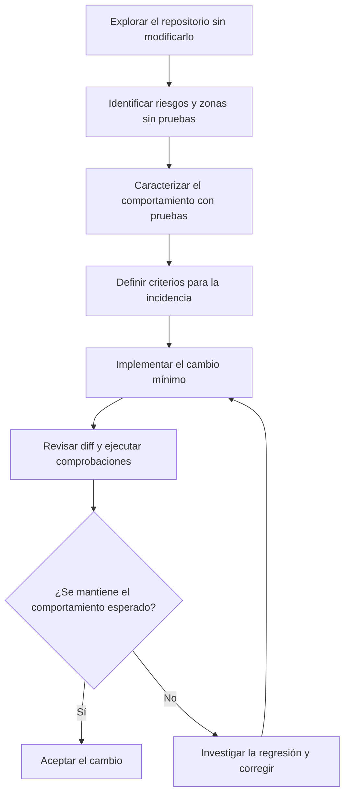

# 03 · Incorporar IA a un proyecto existente

## Objetivo

Aprender a utilizar asistentes en un repositorio que ya tiene estructura, decisiones técnicas y deuda técnica, sin iniciar una reescritura innecesaria.

## Proyecto de práctica

Este directorio contiene un proyecto Python mínimo y ejecutable. Genera entidades GeoJSON para puntos de interés, sin dependencias de geoprocesamiento externas.

Antes de empezar, instala Python 3.11 o posterior y Git. Desde este directorio, instala el proyecto en modo editable con sus dependencias de prueba:

```bash
python -m pip install -e ".[test]"
python -m pytest
```

Las pruebas iniciales deben pasar. Ejecuta `git status` y `git diff` durante el ejercicio para controlar los cambios. Si prefieres no instalar el paquete, también puedes ejecutar las pruebas con `python -m pip install pytest`; la configuración de pytest añade `src` al path.

## Ejercicios

1. **Exploración sin cambios:** pide al asistente que describa la estructura, el punto de entrada, las dependencias y las pruebas existentes. Exige referencias a archivos concretos y comprueba la respuesta.
2. **Mapa de riesgos:** solicita que identifique zonas sin pruebas, dependencias externas y áreas donde un cambio podría tener efectos secundarios. Trata sus conclusiones como hipótesis que debes verificar.
3. **Pruebas de caracterización:** revisa `tests/test_geojson.py` y explica qué comportamiento actual queda fijado por las pruebas. No cambies aún la implementación.
4. **Cambio acotado:** resuelve la [incidencia de validación](docs/incidencia.md). Define primero las pruebas para los criterios de aceptación y acuerda con el asistente las excepciones que deben producirse para entradas inválidas.
5. **Verificación:** ejecuta todas las pruebas; revisa el diff y comprueba que el cambio se limita a la incidencia.
6. **Instrucciones de proyecto:** cuando conozcas las convenciones reales, redacta instrucciones breves para el asistente. Evita reglas redundantes o instrucciones que no puedas comprobar.

El orden importa: primero comprende el comportamiento existente y reduce la incertidumbre; después cambia una parte acotada y verifica que no has introducido regresiones.



## Criterios de aceptación

- No se han alterado archivos fuera del alcance sin una razón explicada.
- El comportamiento previo relevante está cubierto por pruebas de caracterización.
- Los criterios de la incidencia están cubiertos por pruebas automatizadas.
- Las pruebas se ejecutan correctamente y el diff puede revisarse y revertirse con Git.
- Las instrucciones del asistente describen comandos y convenciones reales del repositorio.
- Los riesgos o incertidumbres que no se han podido verificar quedan documentados.

## Regla de trabajo

No empieces pidiendo «mejora todo el proyecto». Empieza por comprender, verificar y modificar una unidad pequeña. El agente acelera el trabajo, pero no sustituye el conocimiento del sistema ni la revisión del desarrollador.
