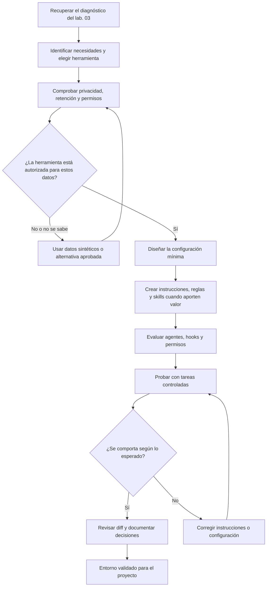

# 04 · Configurar el entorno de desarrollo asistido por IA

## Objetivo

Diseñar, implementar y validar una configuración de IA adecuada para un proyecto existente. El ejercicio parte del diagnóstico del [laboratorio 03](../03-proyecto-existente/README.md) y convierte sus conclusiones en instrucciones, reglas y capacidades reutilizables cuando aporten valor.

Al terminar, el repositorio tendrá una configuración **mínima, explicada y probada** para las herramientas seleccionadas. No se pretende instalar todos los mecanismos disponibles ni asumir que los distintos proveedores ofrecen equivalencias exactas.

## Preparación

- Completa primero el [laboratorio 03](../03-proyecto-existente/README.md), o realiza un diagnóstico equivalente.
- Elige el punto de partida:
  - continúa con la copia del proyecto de práctica preparada en el laboratorio 03;
  - parte del proyecto incluido en [`project/`](project/README.md), que reproduce el estado esperado al terminar el laboratorio 03: el mismo código y un `AGENTS.md` con las instrucciones generales; o
  - utiliza un repositorio propio autorizado y no confidencial.
- Si partes de `project/`, cópialo a un directorio fuera del repositorio de la guía y utiliza allí su propio repositorio Git, igual que en el laboratorio 03.
- Abre únicamente esa copia como espacio de trabajo del asistente y crea allí los archivos de configuración, nunca en la guía. El README de este ejercicio contiene las tareas sugeridas con IA; el README del proyecto documenta el código. Proporciona las instrucciones del ejercicio explícitamente al asistente cuando las necesite. Sigue el [procedimiento común de copia independiente](../README.md#copia-independiente-obligatoria).
- Elige una herramienta principal y, si procede, una segunda herramienta con la que quieras compartir instrucciones.
- Comprueba la documentación oficial vigente y las políticas de tu organización.
- Revisa el estado de Git antes de empezar y trabaja en una rama de ejercicio.
- No añadas credenciales, datos personales ni información de clientes a los archivos de configuración.

## Seguridad y privacidad: comprobar antes de configurar

No presupongas que una suscripción gratuita, una opción para desactivar el entrenamiento o un modo temporal equivalen a **Zero Data Retention (ZDR, retención cero de datos)**. Son controles diferentes. Una opción puede impedir el uso de conversaciones para entrenar modelos sin eliminar el historial ni garantizar que el proveedor no conserve los datos durante un periodo operativo o de seguridad.

Antes de usar una herramienta con código de un proyecto real, comprueba y registra:

1. **Producto, plan y modalidad:** aplicación web, extensión del IDE, CLI, agente en la nube o API pueden tener condiciones distintas, incluso con el mismo proveedor.
2. **Entrenamiento:** si las entradas, el código, las respuestas y los metadatos pueden utilizarse para mejorar modelos; dónde se configura la exclusión y a qué funciones se aplica.
3. **Retención:** qué datos se conservan, durante cuánto tiempo, para qué fines y si existe un compromiso ZDR aplicable a ese producto, plan, modelo y función.
4. **Tratamiento adicional:** proveedores de modelos, subencargados, registros de abuso, telemetría, almacenamiento de sesiones, índices de código y funciones de terceros.
5. **Controles disponibles:** exclusión de archivos, límites de contexto, permisos, tratamiento local frente a procesamiento en la nube y configuración administrada por la organización.
6. **Condiciones contractuales:** requisitos del cliente, NDA, política de seguridad, protección de datos y autorización para compartir código con terceros.

**Regla de decisión:** si no puedes verificar las condiciones aplicables, no envíes código propietario, datos personales, secretos ni información confidencial. Usa un proyecto sintético, datos anonimizados de forma robusta o una alternativa aprobada. Desactivar el entrenamiento no equivale a ZDR; borrar el historial tampoco demuestra que no haya existido retención previa.

No generalices que todos los planes gratuitos tienen las mismas condiciones ni que ningún plan gratuito ofrece controles concretos. Evalúa el servicio exacto y conserva el enlace y la fecha de la documentación consultada. Las garantías contractuales deben verificarse en los términos vigentes, no inferirse a partir de un ajuste de interfaz.

## Conceptos que vas a distinguir

| Necesidad | Mecanismo habitual | Cuándo utilizarlo |
| --- | --- | --- |
| Orientación persistente sobre el proyecto | Instrucciones generales, por ejemplo `AGENTS.md` o el mecanismo propio de la herramienta | Convenciones, arquitectura, comandos y límites que se aplican habitualmente. |
| Instrucciones para una parte del código | Rules o instrucciones por ruta | Reglas específicas para directorios, lenguajes o tipos de archivo. |
| Procedimiento reutilizable | Skill | Flujo de trabajo con pasos, criterios y recursos que el agente debe aplicar cuando corresponda. |
| Rol con responsabilidades delimitadas | Agente personalizado o especializado | Tareas que justifican instrucciones, herramientas o permisos distintos. |
| Control determinista durante el ciclo de trabajo | Hook o mecanismo de evento equivalente | Ejecutar comprobaciones o controles en eventos definidos, sin depender solo de que el modelo los recuerde. |
| Capacidades y límites de ejecución | Ajustes, permisos y configuración del cliente | Definir qué herramientas, comandos, rutas o conexiones están autorizados. |
| Plantilla de tarea invocable manualmente | Prompt reutilizable, si la herramienta lo ofrece | Repetir una petición estructurada sin convertirla en una instrucción permanente. |

Estos mecanismos no son intercambiables. Una instrucción expresa expectativas; una skill describe un procedimiento; un hook ejecuta una acción en un evento; los permisos limitan lo que la herramienta puede hacer.

## Ejercicios

### 1. Diseñar antes de crear archivos

Recupera del laboratorio 03 las convenciones verificadas, los comandos reales, los riesgos y las dudas pendientes. Prepara una tabla de decisión con estas columnas:

- necesidad detectada;
- mecanismo propuesto;
- herramienta y alcance;
- evidencia que justifica la decisión;
- decisión: implementar, posponer o descartar;
- criterio para comprobar que funciona.

No conviertas hipótesis en convenciones. No crees archivos solo porque una herramienta permita crearlos.

### 2. Configurar las instrucciones principales

Parte de las instrucciones generales que ya existan: las que creaste en el laboratorio 03 o el `AGENTS.md` incluido en `project/`. No las aceptes por estar escritas: contrasta cada línea con el código, la configuración y la línea base, corrige lo que no se sostenga y adapta el mecanismo a la herramienta elegida. Consulta [Instrucciones persistentes del proyecto](../../docs/instrucciones-persistentes.md) para los criterios y la forma de comprobar que la herramienta las aplica.

Las instrucciones deben incluir únicamente información útil para tareas recurrentes:

- propósito y arquitectura del proyecto;
- comandos reales para instalar, ejecutar, probar y validar;
- convenciones confirmadas;
- límites de alcance y política para cambios no solicitados;
- requisitos de pruebas, revisión del diff y comunicación de incertidumbres;
- normas de seguridad para secretos y datos sensibles.

Mantén el contenido breve y verificable. Si vas a utilizar varias herramientas, identifica una fuente común cuando sea viable y añade adaptaciones específicas solo donde haya diferencias reales. No supongas que un archivo se lee automáticamente en todos los productos.

### 3. Crear una regla específica

Identifica una convención que solo deba aplicarse a una parte del repositorio. Implementa una regla por ruta o el mecanismo equivalente de la herramienta elegida.

Ejemplos: reglas para pruebas, migraciones, interfaz web o módulos geográficos. Si el proyecto no tiene una necesidad real de alcance específico, documenta por qué no hace falta crearla.

Comprueba tanto un caso en el que la regla deba aplicarse como otro en el que no deba activarse, si la herramienta permite verificarlo.

### 4. Crear una skill para un flujo repetible

Elige una tarea acotada que se repita en el proyecto, como preparar una revisión de cambios, diagnosticar un fallo de pruebas o incorporar una nueva capa de datos.

La skill debe especificar:

- nombre y descripción que permitan identificar cuándo usarla;
- precondiciones y contexto necesario;
- pasos de trabajo;
- comprobaciones y criterios de finalización;
- tratamiento de errores e incertidumbres;
- scripts, ejemplos o referencias auxiliares, solo si son necesarios.

Prueba la skill con una petición que encaje con su propósito y comprueba que no se activa o recomienda indebidamente para una tarea distinta.

### 5. Evaluar agentes especializados y hooks

No es obligatorio implementar ambos. Para cada uno, responde primero a una necesidad concreta.

**Agente especializado:** ¿existe una tarea que requiera un rol claramente separado, instrucciones distintas o un conjunto limitado de herramientas? Si la respuesta es sí, crea uno con responsabilidades y límites explícitos y prueba una tarea representativa.

**Hook:** ¿hay una comprobación que deba ejecutarse en un evento concreto, independientemente de que el agente se acuerde de pedirla? Si la respuesta es sí, implementa un hook sencillo, seguro y documentado. Empieza con una comprobación no destructiva; revisa qué evento lo dispara, qué datos recibe y qué permisos necesita.

Si no hay una justificación suficiente, deja estos mecanismos sin configurar y registra la decisión. No simules un hook mediante instrucciones en lenguaje natural ni confundas un agente especializado con un subagente que la herramienta delega en tiempo de ejecución.

### 6. Revisar ajustes, privacidad y permisos

Inspecciona la configuración de la herramienta y establece el mínimo acceso necesario para el ejercicio.

- Limita comandos y herramientas a los necesarios.
- No guardes tokens, contraseñas ni claves en instrucciones, skills o archivos versionados.
- No habilites acceso a red, MCP, despliegues ni operaciones destructivas si la tarea no los necesita.
- Comprueba qué archivos de configuración son compartidos por el equipo y cuáles son locales o personales.
- Documenta las diferencias entre configuración versionada y configuración externa al repositorio.
- Completa una ficha de privacidad con producto, plan, modalidad de uso, uso para entrenamiento, retención/ZDR, terceros, controles aplicados, fuentes y fecha de consulta.
- Si se utiliza una extensión o agente de IDE, comprueba qué archivos y contexto puede recopilar o enviar, y configura exclusiones donde existan.
- Si el proveedor o la política aplicable no permite verificar las garantías necesarias, usa exclusivamente datos sintéticos o un entorno autorizado.

No copies ajustes de ejemplo sin comprender sus efectos. Los nombres, formatos, opciones y garantías dependen del producto, la función, el plan y su versión.

### 7. Validar con pruebas controladas

Usa al menos dos peticiones: una que deba activar las instrucciones o el mecanismo creado y otra que permita comprobar sus límites. Antes de ejecutar acciones, pide al asistente que explique qué instrucciones aplican y qué comprobaciones realizará.

Verifica:

- que utiliza comandos y convenciones reales;
- que la regla se aplica al ámbito correcto;
- que la skill sigue su procedimiento y criterios de finalización;
- que agentes y hooks, si existen, respetan sus límites;
- que no intenta acceder a secretos ni ejecutar acciones fuera del alcance;
- que las pruebas y comprobaciones producen resultados observables;
- que el contexto compartido con el asistente es compatible con la clasificación de datos y las condiciones de uso documentadas.

Revisa el diff y el estado de Git. Repite el ajuste y la validación si encuentras instrucciones contradictorias, mecanismos que no se activan o permisos excesivos.

## Entregables

- Matriz de decisiones: mecanismos implementados, pospuestos o descartados y motivo.
- Archivos de instrucciones y configuración necesarios para las herramientas elegidas.
- Al menos una skill probada con una tarea representativa.
- Una regla específica validada cuando exista una necesidad real; si no, justificación de su ausencia.
- Decisión documentada sobre agente especializado y hooks.
- Ficha de privacidad y seguridad con fuentes y fecha de consulta, incluyendo el análisis de entrenamiento, retención/ZDR y tratamiento por terceros.
- Registro breve de las pruebas de validación, incidencias y ajustes.
- Diff revisado y estado final de Git.

## Flujo de trabajo

## Criterios de aceptación

- Cada mecanismo implementado responde a una necesidad identificada y documentada.
- Las instrucciones no inventan arquitectura, comandos ni convenciones.
- Las reglas tienen un ámbito explícito y no se aplican indiscriminadamente.
- La skill incluye un procedimiento comprobable y se ha probado.
- Agentes especializados y hooks se incorporan solo si están justificados y soportados por la herramienta.
- Los permisos son proporcionales a la tarea; no se versionan secretos.
- La privacidad se ha evaluado para el producto, plan y modalidad concretos; no se confunde exclusión de entrenamiento con ZDR.
- La ficha de privacidad incluye fuentes y fecha, y no se envían datos no autorizados.
- Las diferencias entre herramientas están documentadas y verificadas en sus fuentes oficiales.
- La validación deja evidencias observables, y el diff y el estado final de Git se han revisado.

## Fuentes oficiales para consultar antes de configurar

La disponibilidad de cada mecanismo y las garantías de datos dependen de la herramienta, la interfaz, la versión y, en algunos casos, el plan. Consulta la documentación del producto concreto antes de implementarlo:

- [Controles de datos de ChatGPT](https://help.openai.com/es-es/articles/7730893-data-controls-in-chatgpt)
- [Cómo se utilizan los datos para mejorar los modelos de OpenAI](https://help.openai.com/es-es/articles/5722486-how-your-data-is-used-to-improve-model-performance)
- [GitHub Copilot: políticas para suscriptores individuales](https://docs.github.com/es/copilot/how-tos/manage-your-account/manage-policies)
- [GitHub Copilot: alojamiento de modelos y compromisos de retención](https://docs.github.com/es/copilot/reference/ai-models/model-hosting)
- [GitHub Copilot: tipos de instrucciones y compatibilidad](https://docs.github.com/en/copilot/reference/custom-instructions-support)
- [Claude Code: memoria e instrucciones del proyecto](https://code.claude.com/docs/en/memory)
- [Claude Code: skills](https://code.claude.com/docs/en/skills)
- [Claude Code: hooks](https://code.claude.com/docs/en/hooks)
- [Claude Code: subagentes](https://code.claude.com/docs/en/sub-agents)
- [Cursor: reglas de proyecto](https://docs.cursor.com/context/rules)
- [Codex: documentación](https://developers.openai.com/codex/)
- [Formato AGENTS.md](https://github.com/agentsmd/agents.md)

## Regla de trabajo

Configura solo lo que puedas explicar, probar y mantener. Un entorno con instrucciones breves, una skill útil, permisos bien definidos y condiciones de privacidad verificadas es preferible a una colección de archivos redundantes que nadie valida.
