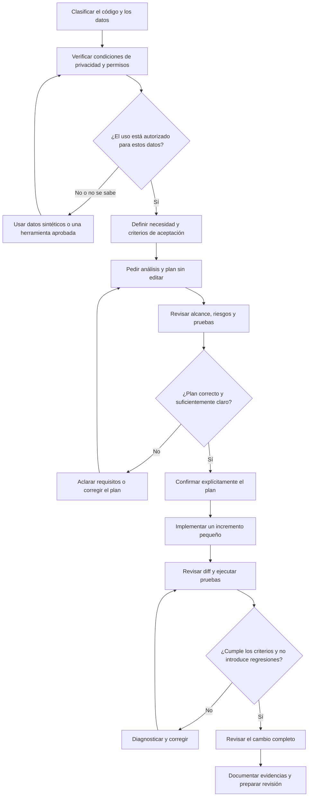

# 05 · Desarrollar una funcionalidad con IA

## Objetivo

Practicar la delegación controlada de una nueva funcionalidad a un asistente de programación. El ejercicio aplica la preparación del [laboratorio 03](../03-proyecto-existente/README.md) y la configuración validada en el [laboratorio 04](../04-configuracion-entorno-ia/README.md).

El objetivo no es conseguir que la IA escriba mucho código, sino completar un cambio pequeño y verificable mediante un proceso explícito: especificar, confirmar el plan, implementar por incrementos, probar y revisar.

## Preparación

- Utiliza la copia independiente del proyecto de los laboratorios anteriores o copia un proyecto de referencia a un directorio fuera del repositorio de la guía. También puedes utilizar un repositorio propio autorizado y no confidencial.
- Abre únicamente esa copia como espacio de trabajo del asistente, nunca la raíz de la guía. Este README contiene las tareas sugeridas con IA; el README del proyecto documenta el código. Proporciona las instrucciones del ejercicio explícitamente al asistente cuando las necesite. Sigue el [procedimiento común de copia independiente](../README.md#copia-independiente-obligatoria).
- Comprueba que el estado de Git está limpio o que cualquier cambio previo está identificado y protegido.
- Verifica que las pruebas de la línea base siguen pasando.
- Comprueba qué instrucciones y mecanismos de configuración aplican a la tarea.
- Selecciona una funcionalidad acotada que pueda describirse mediante criterios de aceptación y probarse localmente.
- No utilices credenciales reales, datos de clientes ni servicios de producción.

Si todavía no existe una propuesta concreta, elige una mejora pequeña del proyecto y pide a la IA que proponga alternativas. La persona responsable debe elegir el alcance final.

### Caso de práctica: incidencia del proyecto del laboratorio 03

El proyecto de práctica incluye una incidencia abierta en `docs/incidencia.md`: validar nombres y coordenadas de `build_feature`. Si la utilizas, aplica el método de este laboratorio con estas indicaciones:

1. Registra `git status --short --branch` y ejecuta las pruebas existentes. Guarda comandos, salidas y limitaciones como línea base; no afirmes que la línea base pasa hasta haber ejecutado las pruebas.
2. Pide al asistente que explique la función y sus riesgos, sin modificar archivos. Contrasta la explicación con el código.
3. Añade en `tests/test_regression.py` pruebas que expresen los criterios de la incidencia. Incluye casos normales, límites, entradas inválidas y la prioridad del argumento `name`.
4. Mantén diferenciados los dos tipos de prueba: las de caracterización describen el comportamiento previo; las de regresión verifican el comportamiento requerido. Si una prueba existente codifica el defecto, actualízala cuando el requisito nuevo lo contradiga, dejando clara la razón.
5. Decide explícitamente qué excepción debe producirse para cada entrada inválida y documenta esa decisión en las pruebas.
6. Solicita un plan pequeño que indique archivos afectados, cambios previstos y pruebas; revísalo y confírmalo antes de permitir ediciones de implementación.
7. Implementa solo lo necesario para resolver la incidencia. No amplíes el alcance con una refactorización general.
8. Ejecuta las pruebas pertinentes y el conjunto completo; registra la salida real y revisa `git diff` y el estado de Git.
9. En el cierre, relaciona cada criterio de aceptación con la prueba o evidencia que lo verifica e indica explícitamente las comprobaciones no ejecutadas.

## Control previo de seguridad y privacidad

Antes de abrir el asistente, aplica la [lista de comprobación de seguridad y privacidad](../../docs/seguridad-privacidad-ia.md). Ten en cuenta el contexto automático: archivos, historial, terminal, logs, resultados de pruebas e integraciones.

- Verifica que el producto, plan y modalidad están autorizados para esos datos.
- Comprueba entrenamiento, retención/ZDR, terceros, permisos y exclusiones disponibles.
- No incluyas secretos ni datos confidenciales si no se ha confirmado la autorización.
- Si hay dudas, utiliza datos sintéticos o una herramienta aprobada.
- Registra la decisión, las fuentes y la fecha.

La exclusión del entrenamiento no garantiza retención cero. Reevalúa las condiciones si cambia la herramienta o la información utilizada.

## Método: confirmar antes de implementar

### 1. Definir el resultado esperado

Redacta una petición breve que incluya:

- problema o necesidad que se quiere resolver;
- comportamiento esperado desde la perspectiva del usuario o de quien consume la API;
- criterios de aceptación observables;
- restricciones y aspectos explícitamente fuera de alcance;
- requisitos de compatibilidad, seguridad y calidad que correspondan.

Evita prescribir detalles internos sin necesidad. La implementación puede proponerlos, pero debe respetar la arquitectura y las convenciones confirmadas del proyecto.

### 2. Pedir análisis y plan, sin modificar código

Solicita al asistente que inspeccione el repositorio y presente:

- archivos y componentes que probablemente cambiarían;
- solución propuesta y alternativas relevantes;
- pasos pequeños de implementación;
- pruebas que cubrirían los criterios de aceptación;
- riesgos, dependencias, supuestos e incertidumbres;
- posibles cambios de API, datos, configuración o documentación.

En esta fase, indica explícitamente que no debe editar archivos ni ejecutar acciones destructivas.

### 3. Revisar y confirmar el plan

Antes de permitir la implementación, comprueba que:

- el plan responde a todos los criterios de aceptación;
- las modificaciones propuestas son proporcionales al alcance;
- se reutilizan las abstracciones existentes cuando procede;
- se incluyen pruebas positivas, negativas y casos límite relevantes;
- no se introducen dependencias, servicios o permisos innecesarios;
- las dudas que puedan cambiar la solución se han resuelto;
- el plan no propone compartir información con servicios o herramientas no autorizados.

Corrige el plan con el asistente y confirma expresamente la versión que se va a ejecutar. Si faltan requisitos, vuelve a la especificación; no delegues decisiones de producto ambiguas.

### 4. Implementar por incrementos

Autoriza un paso cada vez cuando el cambio lo justifique. Después de cada incremento:

1. inspecciona el diff;
2. comprueba que el cambio corresponde al plan confirmado;
3. ejecuta las pruebas pertinentes;
4. revisa errores y regresiones;
5. decide si continuar, corregir o revertir el incremento.

Para una tarea trivial puede bastar un único incremento, pero deben mantenerse la revisión y la validación. Si la implementación requiere habilitar una nueva integración, permiso, servicio remoto o envío de datos, detente y evalúa el cambio antes de autorizarlo.

### 5. Verificar el resultado

Pide al asistente que relacione cada criterio de aceptación con la prueba o evidencia que lo demuestra. Ejecuta tú mismo los comandos pertinentes y comprueba los resultados. Conserva la línea base obtenida antes del cambio para poder distinguir fallos preexistentes de regresiones; no compares solo el número de pruebas ni des por válida una prueba porque exista en el repositorio.

Como mínimo:

- ejecuta las pruebas nuevas y las de regresión;
- ejecuta las comprobaciones de calidad disponibles en el proyecto;
- revisa los errores, los casos límite y el manejo de entradas no válidas;
- comprueba la documentación afectada;
- inspecciona el diff completo y el estado de Git;
- distingue las comprobaciones realizadas de las que no se han podido ejecutar;
- relaciona cada criterio de aceptación con una prueba o evidencia concreta y señala cualquier criterio aún no cubierto;
- comprueba que no se han incorporado credenciales, datos sensibles, dependencias o permisos no autorizados.

No aceptes como evidencia una afirmación del asistente sin un resultado observable. Si una prueba falla, investiga si el fallo pertenece al cambio, a la línea base o al entorno.

### 6. Cerrar el cambio

Prepara un resumen breve con:

- comportamiento añadido;
- decisiones principales;
- archivos modificados;
- pruebas ejecutadas y resultados;
- limitaciones o riesgos pendientes;
- decisión de privacidad y cualquier limitación relevante;
- desviaciones respecto al plan confirmado.

Si el proyecto utiliza pull requests, entrega el cambio para revisión; no lo integres automáticamente en la rama principal. Crea un commit solo después de revisar el cambio y de acuerdo con las convenciones del proyecto.

## Registro del ejercicio

Completa esta tabla en la documentación del ejercicio o en un informe breve:

| Fase | Evidencia que se debe conservar |
| --- | --- |
| Privacidad | Producto, plan y modalidad; clasificación de datos; controles de entrenamiento y retención/ZDR; fuentes y fecha; decisión de uso. |
| Especificación | Petición y criterios de aceptación confirmados. |
| Planificación | Plan propuesto por la IA y correcciones humanas. |
| Confirmación | Versión del plan autorizada antes de editar código. |
| Implementación | Resumen de incrementos y decisiones de revisión. |
| Validación | Línea base y resultado posterior, comandos ejecutados, resultados y relación entre criterios y pruebas. |
| Cierre | Diff revisado, estado de Git, limitaciones y siguiente paso. |

## Diagrama del flujo

## Criterios de aceptación

- La información que se comparte con la herramienta se ha clasificado y su uso está autorizado.
- La decisión de privacidad identifica producto, plan y modalidad concretos; no confunde exclusión de entrenamiento con ZDR.
- La funcionalidad tiene criterios de aceptación concretos antes de implementar.
- La IA presenta un plan antes de modificar el código.
- El plan se revisa y confirma explícitamente; no se autoriza un alcance ambiguo.
- La implementación sigue el plan o documenta las desviaciones y obtiene confirmación cuando cambia el alcance.
- Las pruebas cubren el comportamiento esperado y los casos relevantes de regresión.
- Las comprobaciones se ejecutan y sus resultados se registran sin afirmar validaciones no realizadas.
- Se ha revisado el diff completo y el estado de Git, incluidos posibles secretos y cambios de permisos.
- El cierre distingue resultados demostrados, limitaciones y trabajo pendiente.

## Relación con los demás laboratorios

- **Lab. 03:** aporta el diagnóstico, la línea base y los riesgos del proyecto.
- **Lab. 04:** aporta instrucciones y mecanismos de configuración validados, además de la evaluación de privacidad y permisos.
- **Lab. 05:** aplica ese contexto para desarrollar una funcionalidad con planificación confirmada y revisión humana.

## Fuentes de privacidad para consultar

Las condiciones cambian según el producto, el plan y la función utilizada. Consulta la documentación oficial antes de cada ejercicio y vuelve a comprobarla cuando cambie la configuración:

- [Controles de datos de ChatGPT](https://help.openai.com/es-es/articles/7730893-data-controls-in-chatgpt)
- [Uso de datos para mejorar los modelos de OpenAI](https://help.openai.com/es-es/articles/5722486-how-your-data-is-used-to-improve-model-performance)
- [Políticas de GitHub Copilot para suscriptores individuales](https://docs.github.com/es/copilot/how-tos/manage-your-account/manage-policies)
- [Alojamiento de modelos y compromisos de retención de GitHub Copilot](https://docs.github.com/es/copilot/reference/ai-models/model-hosting)

## Principio de trabajo

La IA puede analizar, proponer, implementar y ayudar a verificar. La persona responsable conserva la decisión sobre requisitos, alcance, permisos, aceptación, tratamiento de datos y entrega del cambio.
