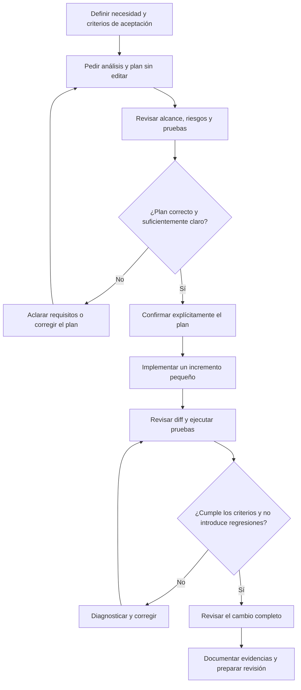

# 05 · Desarrollar una funcionalidad con IA

## Objetivo

Practicar la delegación controlada de una nueva funcionalidad a un asistente de programación. El ejercicio aplica la preparación del [laboratorio 03](../03-proyecto-existente/README.md) y la configuración validada en el [laboratorio 04](../04-configuracion-entorno-ia/README.md).

El objetivo no es conseguir que la IA escriba mucho código, sino completar un cambio pequeño y verificable mediante un proceso explícito: especificar, confirmar el plan, implementar por incrementos, probar y revisar.

## Preparación

- Utiliza el proyecto de práctica de los laboratorios anteriores o un repositorio propio autorizado y no confidencial.
- Comprueba que el estado de Git está limpio o que cualquier cambio previo está identificado y protegido.
- Verifica que las pruebas de la línea base siguen pasando.
- Comprueba qué instrucciones y mecanismos de configuración aplican a la tarea.
- Selecciona una funcionalidad acotada que pueda describirse mediante criterios de aceptación y probarse localmente.
- No utilices credenciales reales, datos de clientes ni servicios de producción.

Si todavía no existe una propuesta concreta, elige una mejora pequeña del proyecto y pide a la IA que proponga alternativas. La persona responsable debe elegir el alcance final.

## Método: confirmar antes de implementar

### 1. Definir el resultado esperado

Redacta una petición breve que incluya:

- problema o necesidad que se quiere resolver;
- comportamiento esperado desde la perspectiva del usuario o de quien consume la API;
- criterios de aceptación observables;
- restricciones y aspectos explícitamente fuera de alcance;
- requisitos de compatibilidad, seguridad y calidad que correspondan.

Evita prescribir detalles internos sin necesidad. La implementación puede proponerlos, pero debe respetar la arquitectura y las convenciones confirmadas del proyecto.

### 2. Pedir análisis y plan, sin modificar código

Solicita al asistente que inspeccione el repositorio y presente:

- archivos y componentes que probablemente cambiarían;
- solución propuesta y alternativas relevantes;
- pasos pequeños de implementación;
- pruebas que cubrirían los criterios de aceptación;
- riesgos, dependencias, supuestos e incertidumbres;
- posibles cambios de API, datos, configuración o documentación.

En esta fase, indica explícitamente que no debe editar archivos ni ejecutar acciones destructivas.

### 3. Revisar y confirmar el plan

Antes de permitir la implementación, comprueba que:

- el plan responde a todos los criterios de aceptación;
- las modificaciones propuestas son proporcionales al alcance;
- se reutilizan las abstracciones existentes cuando procede;
- se incluyen pruebas positivas, negativas y casos límite relevantes;
- no se introducen dependencias, servicios o permisos innecesarios;
- las dudas que puedan cambiar la solución se han resuelto.

Corrige el plan con el asistente y confirma expresamente la versión que se va a ejecutar. Si faltan requisitos, vuelve a la especificación; no delegues decisiones de producto ambiguas.

### 4. Implementar por incrementos

Autoriza un paso cada vez cuando el cambio lo justifique. Después de cada incremento:

1. inspecciona el diff;
2. comprueba que el cambio corresponde al plan confirmado;
3. ejecuta las pruebas pertinentes;
4. revisa errores y regresiones;
5. decide si continuar, corregir o revertir el incremento.

Para una tarea trivial puede bastar un único incremento, pero deben mantenerse la revisión y la validación.

### 5. Verificar el resultado

Pide al asistente que relacione cada criterio de aceptación con la evidencia que lo demuestra. Ejecuta tú mismo los comandos pertinentes y comprueba los resultados.

Como mínimo:

- ejecuta las pruebas nuevas y las de regresión;
- ejecuta las comprobaciones de calidad disponibles en el proyecto;
- revisa los errores, los casos límite y el manejo de entradas no válidas;
- comprueba la documentación afectada;
- inspecciona el diff completo y el estado de Git;
- distingue las comprobaciones realizadas de las que no se han podido ejecutar.

No aceptes como evidencia una afirmación del asistente sin un resultado observable. Si una prueba falla, investiga si el fallo pertenece al cambio, a la línea base o al entorno.

### 6. Cerrar el cambio

Prepara un resumen breve con:

- comportamiento añadido;
- decisiones principales;
- archivos modificados;
- pruebas ejecutadas y resultados;
- limitaciones o riesgos pendientes;
- desviaciones respecto al plan confirmado.

Si el proyecto utiliza pull requests, entrega el cambio para revisión; no lo integres automáticamente en la rama principal. Crea un commit solo después de revisar el cambio y de acuerdo con las convenciones del proyecto.

## Registro del ejercicio

Completa esta tabla en la documentación del ejercicio o en un informe breve:

| Fase | Evidencia que se debe conservar |
| --- | --- |
| Especificación | Petición y criterios de aceptación confirmados. |
| Planificación | Plan propuesto por la IA y correcciones humanas. |
| Confirmación | Versión del plan autorizada antes de editar código. |
| Implementación | Resumen de incrementos y decisiones de revisión. |
| Validación | Comandos ejecutados, resultados y criterios cubiertos. |
| Cierre | Diff revisado, estado de Git, limitaciones y siguiente paso. |

## Diagrama del flujo

## Criterios de aceptación

- La funcionalidad tiene criterios de aceptación concretos antes de implementar.
- La IA presenta un plan antes de modificar el código.
- El plan se revisa y confirma explícitamente; no se autoriza un alcance ambiguo.
- La implementación sigue el plan o documenta las desviaciones y obtiene confirmación cuando cambia el alcance.
- Las pruebas cubren el comportamiento esperado y los casos relevantes de regresión.
- Las comprobaciones se ejecutan y sus resultados se registran sin afirmar validaciones no realizadas.
- Se ha revisado el diff completo y el estado de Git.
- El cierre distingue resultados demostrados, limitaciones y trabajo pendiente.

## Relación con los demás laboratorios

- **Lab. 03:** aporta el diagnóstico, la línea base y los riesgos del proyecto.
- **Lab. 04:** aporta instrucciones y mecanismos de configuración validados.
- **Lab. 05:** aplica ese contexto para desarrollar una funcionalidad con planificación confirmada y revisión humana.

## Principio de trabajo

La IA puede analizar, proponer, implementar y ayudar a verificar. La persona responsable conserva la decisión sobre requisitos, alcance, permisos, aceptación y entrega del cambio.
